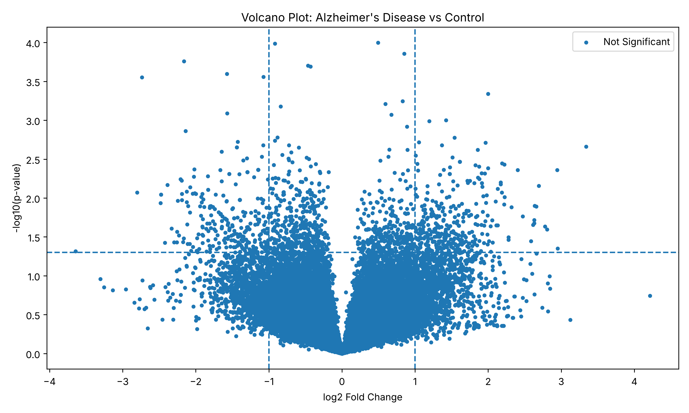
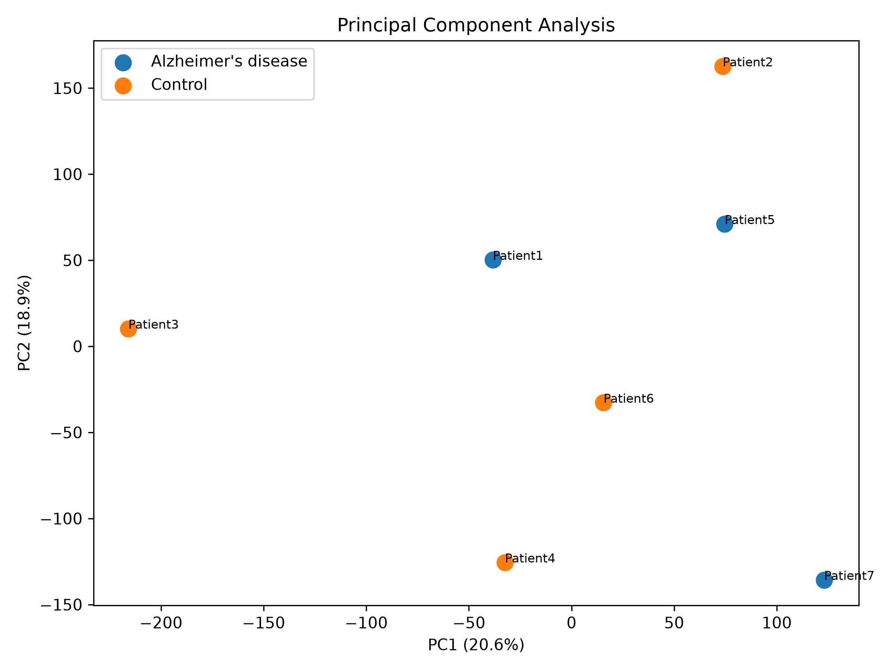

# Alzheimer's disease RNA-seq (GSE163877): an exploratory analysis with a null result

I started this project to look for genes and pathways that differ between
Alzheimer's disease and control brain tissue, using public RNA-seq data from
GEO. After fixing a multiple-testing bug, the honest answer is that this
dataset is too small to call any gene differentially expressed. The repository
now documents that result and the pipeline that produced it.

## Dataset

| | |
|---|---|
| GEO accession | [GSE163877](https://www.ncbi.nlm.nih.gov/geo/query/acc.cgi?acc=GSE163877) |
| Organism | *Homo sapiens* |
| Tissue | Post-mortem middle temporal gyrus |
| Samples | 3 Alzheimer's disease, 4 control |
| Data | Coding and non-coding RNA-seq counts |

## Result

| | Genes |
|---|---|
| Tested | 52,253 |
| Unadjusted p < 0.05 | 1,548 |
| Benjamini-Hochberg FDR < 0.05 | 0 |

The smallest adjusted p-value is 0.91. With 52,253 tests you would expect
around 2,600 genes below p = 0.05 by chance alone, so 1,548 is no evidence of a
real signal. With 3 versus 4 samples the study only has power to detect very
large effects.



I reached the same conclusion with a separate method in
[count-de-benchmark](https://github.com/iraajgangavaram/count-de-benchmark),
which reanalyses this dataset with median-of-ratios normalisation and an
empirical-Bayes moderated t-test. No gene passes 10% FDR there either, and the
p-value histogram is close to flat. That project also uses simulations to show
how many replicates you need before a moderated test starts finding true
changes.

## What changed and why

The first version of this pipeline reported "significant" genes and pathways.
Two bugs in `src/differential_expression.py` caused this:

- **Every adjusted p-value was NaN.** 6,534 genes have identical values in all
  samples, so their t-test p-value is undefined. These were passed to the
  Benjamini-Hochberg correction, which then returned NaN for every gene. They
  are now excluded before correction.
- **Degenerate tests looked like the strongest hits.** Genes with zero variance
  in both groups (for example counts 2, 2, 2 against 0, 0, 0, 0) gave a p-value
  of exactly 0. These 38 genes are now treated as untestable.

The GO, KEGG, STRING network and hub-gene results were built from the
"top 200 genes by adjusted p-value" while every adjusted p-value was NaN, so
that gene list was effectively arbitrary. I have removed those outputs rather
than leave misleading figures in the repository. The scripts are still here and
can be rerun on the corrected ranking, but any result should be read as
exploratory, because no gene in the ranking is significant.

## Pipeline

| Step | Script | Output |
|---|---|---|
| Download | `src/download_data.py` | Raw counts in `data/raw/` (not tracked) |
| Preprocess | `src/preprocess.py` | `data/processed/expression_matrix.csv` |
| Quality control | `src/quality_control.py`, `notebooks/02_quality_control.ipynb` | Distribution, correlation and PCA plots in `figures/` |
| Differential expression | `src/differential_expression.py` | `results/differential_expression_results.csv` |
| Volcano plot | `src/volcano_plot.py` | `figures/volcano_plot.png` |
| Gene symbols | `src/gene_annotation.py` | Gene-symbol table for the steps below |
| Enrichment | `src/go_enrichment.py`, `src/kegg_enrichment.py` | GO and KEGG tables and bar plots |
| Network | `src/string_network.py`, `src/hub_analysis.py` | STRING interactions and hub genes |
| Heatmap | `src/heatmap.py` | Top-ranked genes across samples |
| Dashboard | `src/dashboard.py` | Streamlit summary of whatever outputs exist |

The differential expression step uses Welch's t-test on log2(count + 1) for
each gene, with Benjamini-Hochberg correction. The annotation, enrichment and
STRING steps call online services, so they need internet access.



## Running it

```bash
pip install -r requirements.txt
python src/download_data.py
python src/preprocess.py
python src/differential_expression.py
python src/volcano_plot.py
streamlit run src/dashboard.py
```

Run the scripts from the repository root.

## Limitations

- Seven samples give very little statistical power.
- Counts are log-transformed without library-size normalisation. A proper
  analysis would use size factors or TMM, as DESeq2 and edgeR do (and as
  count-de-benchmark does).
- A t-test on 3 versus 4 samples has very noisy variance estimates. Moderated
  tests such as limma or DESeq2 handle this better.
- Post-mortem tissue brings confounders (age, post-mortem interval, RNA
  quality) that this analysis does not model.

## What would make this work

The question needs more samples. Larger AD RNA-seq cohorts such as the AMP-AD
studies (ROSMAP, Mayo, MSBB) have hundreds of samples, and analysing one of
them with DESeq2 or limma-voom would be the natural next step.

## Repository layout

```text
data/metadata/     sample groups and GEO metadata
data/processed/    expression matrix
figures/           QC plots and volcano plot
notebooks/         quality control notebook
results/           differential expression tables
screenshots/       images used in this README
src/               pipeline scripts and dashboard
src/archive/       earlier exploratory scripts
```

## Licence

MIT. See [LICENSE](LICENSE).
